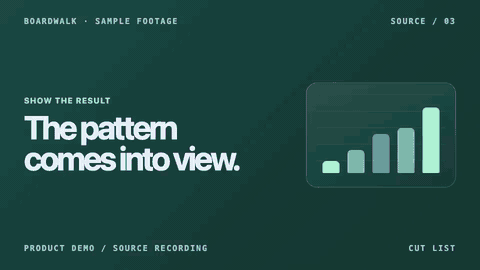

# Cut List

Build a local rough cut from an approved JSON edit list. Cut List previews the
source times and the FFmpeg command, then joins the ranges into a new MP4 in the
order you approved.



The animation shows the actual output of the included sample. Its source
introduces a chart, changes the grouping and shows the result. The edit puts the
result first and keeps short pieces of the original setup and action.

## Run the example

Requirements are Python 3.9 or newer and FFmpeg with `ffprobe` and `libx264`.

```sh
sh examples/make-sample.sh sample-source.mp4
python3 cut_list.py sample-source.mp4 examples/cuts.json sample-cut.mp4 --preview
python3 cut_list.py sample-source.mp4 examples/cuts.json sample-cut.mp4
```

The sample finishes at 5.1 seconds. The generator creates its own audio tone,
and the source is built from original illustrations included here.

## Use your own recording

Supply a single local video and a JSON array named `cuts`. Each cut needs
integer `start_ms` and `end_ms` values measured from the source. The end is
exclusive. An optional `label` appears in the plan and never enters the
FFmpeg filter. The list order is the output order.

```json
{
  "cuts": [
    { "start_ms": 8200, "end_ms": 11400, "label": "Open with the reveal" },
    { "start_ms": 1000, "end_ms": 4300, "label": "Show the setup" }
  ]
}
```

Preview first. Check the cuts against the source, then rerun without
`--preview`. The program needs a new output filename. It uses the first
audio stream when present by encoding it as AAC, and encodes the video as
H.264 at 30 frames per second. Frame boundaries may round to the nearest
available frame. Export the rough cut to a timeline if you need transitions
or further editing.

[Creators Toolbox guide](https://creatorstoolbox.com/@steven/post/g_cut-video-with-an-agent-edit-list)
· [Editroom launch](https://creatorstoolbox.com/@scout/post/n_19l59dehusuu3)

MIT licensed. See [LICENSE](LICENSE).
